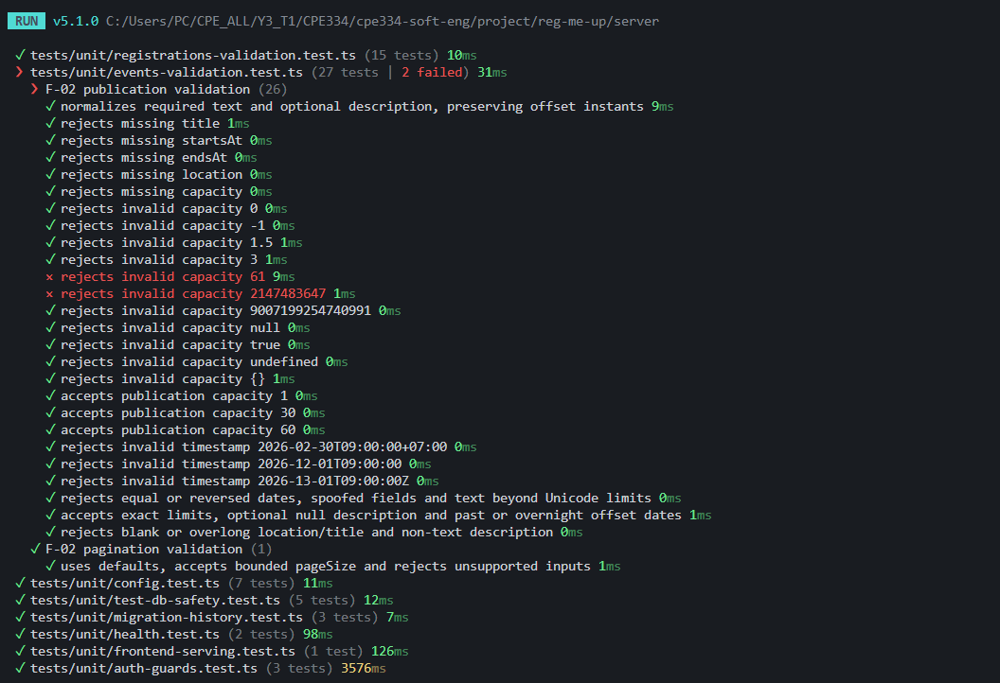
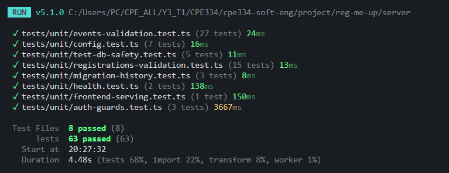
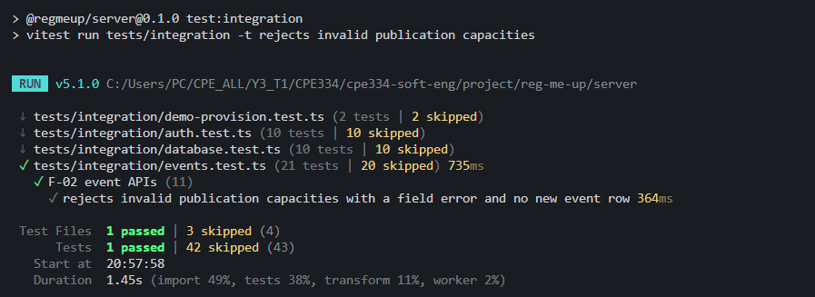
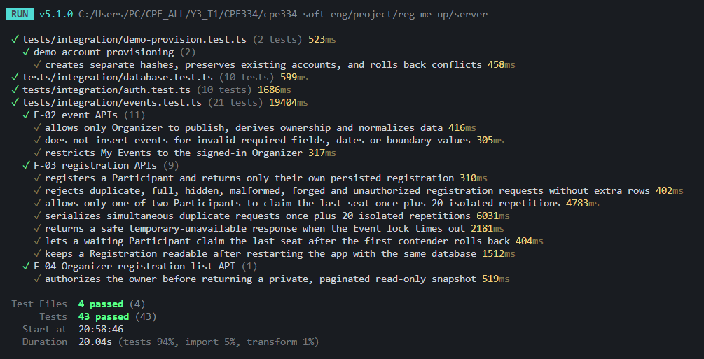

# Lab 7 Test Evidence — Publish Capacity 1–60

## RED run

| Field | Recorded value |
|---|---|
| Phase | Expected RED — test-only change, before production implementation |
| Command | `npm run test:unit --workspace server` |
| Runner | Vitest 5.1.0 |
| Run time shown | 20:10:15 (local terminal) |
| Result | 7 test files passed, 1 failed; 61 tests passed, 2 failed (63 total) |
| Failing test file | `server/tests/unit/events-validation.test.ts` |
| Failing cases | Reject capacity `61`; reject previous maximum `2147483647` |
| Failure observed | Both expected a capacity validation error (`true`) but received `undefined`; current implementation still accepts these values. |
| Interpretation | Expected RED for the new upper bound, rather than a compile or environment failure. Other unit suites passed in this run. |
| Tested commit | `d8b0d18` (`test: add RED coverage for publish capacity 1-60`) |
| Integration test | See attempts below: initial setup/seed issues resolved; targeted GREEN and full 43-test regression recorded. |

The RED screenshots record the two expected failures before the production change; the matching GREEN unit run and integration reproduction/GREEN results are recorded below.

## Screenshot evidence

### Vitest summary

### Failing assertions

## GREEN run

| Field | Recorded value |
|---|---|
| Phase | GREEN — after server and client enforce publication capacity 1–60 |
| Command | `npm run test:unit --workspace server` |
| Runner | Vitest 5.1.0 |
| Run time shown | 20:27:32 (local terminal) |
| Tested commit | `db09ba6` (`fix: enforce event publish capacity 1-60`) |
| Result | 8 test files passed; 63 of 63 tests passed |
| Integration test | Latest full run at 20:58:46 passed all 43 tests; earlier attempts retained below. |

## Integration setup attempt

| Field | Recorded value |
|---|---|
| Command | `npm run test:integration --workspace server` |
| Run time shown | 20:32:08 |
| Tested commit | `db09ba6` (`fix: enforce event publish capacity 1-60`) |
| Result | 4 integration suites stopped during `beforeAll`; 43 tests skipped; no integration assertions ran. |
| Cause | `DATABASE_URL` and `TEST_DATABASE_URL` were not set in the test process. |
| Classification | Setup blocked — not a pass or a logic failure. |
| Next step | Configure separate, verified database URLs and the test-only database identity, then rerun migrations/setup as required and repeat the integration command. |

## Integration run — seed password verification failures

| Field | Recorded value |
|---|---|
| Command | `npm run test:integration --workspace server` |
| Run time shown | 20:42:29 |
| Source revision | Current implementation HEAD `db09ba6`; supplied terminal output does not display the SHA. |
| Result | 2 files passed, 2 failed; 41 tests passed, 2 failed (43 total). |
| Event coverage | `events.test.ts`: all 21 tests passed, including publish boundary cases and registration regression. This suite does not yet include the planned legacy-capacity-61 registration case. |
| Failing cases | `auth.test.ts`: separate salt/hash verification; `database.test.ts`: seeded password hash verification. |
| Observed failure | Stored seeded password hash fails verification against the current `SEED_PASSWORD`. |
| Diagnosis | Consistent with an existing seed created using a different password. The seed uses `upsert` with `update: {}`, so rerunning it preserves existing hashes. Original seed password is not established by this output. |
| Next step | Set `SEED_PASSWORD` to the original synthetic seed password and rerun; if unavailable, prepare an explicit, guarded refresh of only synthetic test-account hashes. Do not reset or delete the database. |

Source: user-supplied terminal output. This historical failed attempt is retained; the latest passing regression run is recorded below. No independent test run was performed by the assistant.

## Integration RED reproduction

| Field | Recorded value |
|---|---|
| Command | `npm run test:integration --workspace server -- -t "rejects invalid publication capacities"` |
| Run time shown | 20:53:44 |
| Source revision | HEAD `db09ba6` with an uncommitted change restoring only `server/src/events-validation.ts` to its pre-change logic (upper bound 2147483647 and previous error text); test file unchanged. This is a later reproduction, not a run at the original RED commit. |
| Environment reported by user | Local Docker project `lab6-capacity-regression`, PostgreSQL port 55433; application database `regmeup_dev`, isolated test database `regmeup_test`. |
| Result | 1 test failed, 42 skipped; 1 file failed, 3 skipped. Skips are intentional because of the test-name filter. |
| Assertion | `capacity case 61: expected 201 to be 422`; API accepted the invalid new-publication capacity under the old validator. |
| Interpretation | Expected RED from a behavior assertion; database setup completed. The test stops at the response-status assertion, so this RED run does not reach the final no-new-event-row assertion. |
| Restoration | Restored server validator to the committed GREEN logic (integer 1–60) after collecting RED evidence. Matching targeted GREEN rerun passed at 20:57:58, recorded below. |

## Integration GREEN — matching targeted case

| Field | Recorded value |
|---|---|
| Command | `npm run test:integration --workspace server -- -t "rejects invalid publication capacities"` |
| Run time shown | 20:57:58 |
| Source | GREEN implementation `db09ba6`; working-tree server/client source matches HEAD on inspection. Screenshot does not independently display the SHA. |
| Result | 1 test passed, 42 intentionally skipped; 1 file passed, 3 skipped. |
| Assertions reached | Invalid capacity responses have status422, VALIDATION_ERROR and a capacity field error; event count for the fixture owner is unchanged. |

## Integration GREEN — full regression

| Field | Recorded value |
|---|---|
| Command reported | `npm run test:integration --workspace server` (the capture begins at the Vitest RUN line). |
| Run time shown | 20:58:46 |
| Source | GREEN implementation `db09ba6`; screenshot does not independently display the SHA. |
| Result | 4 files passed; 43 tests passed; no failed or skipped cases shown. |
| Coverage | Existing database, auth, demo provisioning and event API suites, including publish boundaries, authorization, full/duplicate/concurrent registration and persisted retrieval after restart. |
| Limit | This suite does not yet include the planned capacity61/ACTIVE60 legacy registration fixture or browser UI verification. |

## Remaining evidence

1. Capture create-event UI behavior for invalid capacity 61 (inline range error, form retained, no publication), and successful publication/retrieval at 1, 30 and 60. Record version, expected/actual and event IDs where applicable. Unit/API evidence does not establish browser behavior.
2. Planned legacy capacity61 read/registration coverage and target legacy-data audit are still outstanding; existing event suite does not include the synthetic capacity61/ACTIVE60 registration case. Capture after that case is implemented and actually run.

All screenshots were supplied by the user. Unit and current integration suite evidence is complete for these runs; remaining UI/legacy work is not implied to have passed.
