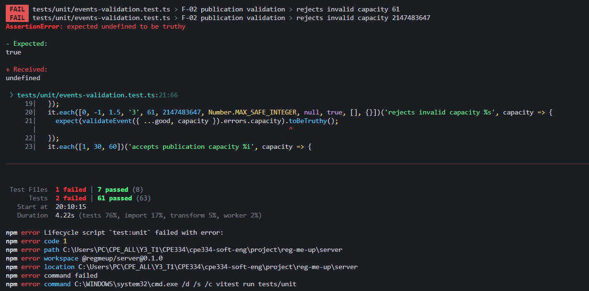

# Lab 7 RED Evidence — Publish Capacity 1–60

| Field | Recorded value |
|---|---|
| Phase | RED — test-only change, before production implementation |
| Command | `npm run test:unit --workspace server` |
| Runner | Vitest 5.1.0 |
| Run time shown | 20:10:15 (local terminal) |
| Result | 7 test files passed, 1 failed; 61 tests passed, 2 failed (63 total) |
| Failing test file | `server/tests/unit/events-validation.test.ts` |
| Failing cases | Reject capacity `61`; reject previous maximum `2147483647` |
| Failure observed | Both expected a capacity validation error (`true`) but received `undefined`; current implementation still accepts these values. |
| Interpretation | Expected RED for the new upper bound, rather than a compile or environment failure. Other unit suites passed in this run. |
| Tested commit | `d8b0d18` (`test: add RED coverage for publish capacity 1-60`) |
| Integration test | Not shown in the supplied evidence; status remains NOT RUN until an actual run is recorded. |

The supplied screenshots show the Vitest summary and both assertion failures. Do not report GREEN until the same tests pass after the production validation change.

## Screenshot evidence

### Vitest summary

### Failing assertions

