# Lab 7 Test Evidence — Publish Capacity 1–60

## RED run

| Field | Recorded value |
|---|---|
| Phase | Expected RED — test-only change, before production implementation |
| Command | `npm run test:unit --workspace server` |
| Runner | Vitest 5.1.0 |
| Run time shown | 20:10:15 (local terminal) |
| Result | 7 test files passed, 1 failed; 61 tests passed, 2 failed (63 total) |
| Failing test file | `server/tests/unit/events-validation.test.ts` |
| Failing cases | Reject capacity `61`; reject previous maximum `2147483647` |
| Failure observed | Both expected a capacity validation error (`true`) but received `undefined`; current implementation still accepts these values. |
| Interpretation | Expected RED for the new upper bound, rather than a compile or environment failure. Other unit suites passed in this run. |
| Tested commit | `d8b0d18` (`test: add RED coverage for publish capacity 1-60`) |
| Integration test | See attempts below: initial setup/seed issues resolved; targeted GREEN and full 43-test regression recorded. |

The RED screenshots record the two expected failures before the production change; the matching GREEN unit run and integration reproduction/GREEN results are recorded below.

## Screenshot evidence

### Vitest summary

### Failing assertions

## GREEN run

| Field | Recorded value |
|---|---|
| Phase | GREEN — after server and client enforce publication capacity 1–60 |
| Command | `npm run test:unit --workspace server` |
| Runner | Vitest 5.1.0 |
| Run time shown | 20:27:32 (local terminal) |
| Tested commit | `db09ba6` (`fix: enforce event publish capacity 1-60`) |
| Result | 8 test files passed; 63 of 63 tests passed |
| Integration test | Latest full run at 20:58:46 passed all 43 tests; earlier attempts retained below. |

## Integration setup attempt

| Field | Recorded value |
|---|---|
| Command | `npm run test:integration --workspace server` |
| Run time shown | 20:32:08 |
| Tested commit | `db09ba6` (`fix: enforce event publish capacity 1-60`) |
| Result | 4 integration suites stopped during `beforeAll`; 43 tests skipped; no integration assertions ran. |
| Cause | `DATABASE_URL` and `TEST_DATABASE_URL` were not set in the test process. |
| Classification | Setup blocked — not a pass or a logic failure. |
| Next step | Configure separate, verified database URLs and the test-only database identity, then rerun migrations/setup as required and repeat the integration command. |

## Integration run — seed password verification failures

| Field | Recorded value |
|---|---|
| Command | `npm run test:integration --workspace server` |
| Run time shown | 20:42:29 |
| Source revision | Current implementation HEAD `db09ba6`; supplied terminal output does not display the SHA. |
| Result | 2 files passed, 2 failed; 41 tests passed, 2 failed (43 total). |
| Event coverage | `events.test.ts`: all 21 tests passed, including publish boundary cases and registration regression. This suite does not yet include the planned legacy-capacity-61 registration case. |
| Failing cases | `auth.test.ts`: separate salt/hash verification; `database.test.ts`: seeded password hash verification. |
| Observed failure | Stored seeded password hash fails verification against the current `SEED_PASSWORD`. |
| Diagnosis | Consistent with an existing seed created using a different password. The seed uses `upsert` with `update: {}`, so rerunning it preserves existing hashes. Original seed password is not established by this output. |
| Next step | Set `SEED_PASSWORD` to the original synthetic seed password and rerun; if unavailable, prepare an explicit, guarded refresh of only synthetic test-account hashes. Do not reset or delete the database. |

Source: user-supplied terminal output. This historical failed attempt is retained; the latest passing regression run is recorded below. No independent test run was performed by the assistant.

## Integration RED reproduction

| Field | Recorded value |
|---|---|
| Command | `npm run test:integration --workspace server -- -t "rejects invalid publication capacities"` |
| Run time shown | 20:53:44 |
| Source revision | HEAD `db09ba6` with an uncommitted change restoring only `server/src/events-validation.ts` to its pre-change logic (upper bound 2147483647 and previous error text); test file unchanged. This is a later reproduction, not a run at the original RED commit. |
| Environment reported by user | Local Docker project `lab6-capacity-regression`, PostgreSQL port 55433; application database `regmeup_dev`, isolated test database `regmeup_test`. |
| Result | 1 test failed, 42 skipped; 1 file failed, 3 skipped. Skips are intentional because of the test-name filter. |
| Assertion | `capacity case 61: expected 201 to be 422`; API accepted the invalid new-publication capacity under the old validator. |
| Interpretation | Expected RED from a behavior assertion; database setup completed. The test stops at the response-status assertion, so this RED run does not reach the final no-new-event-row assertion. |
| Restoration | Restored server validator to the committed GREEN logic (integer 1–60) after collecting RED evidence. Matching targeted GREEN rerun passed at 20:57:58, recorded below. |

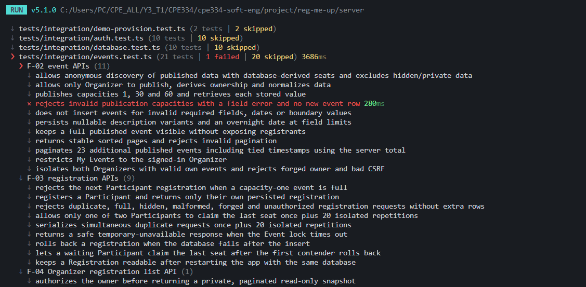

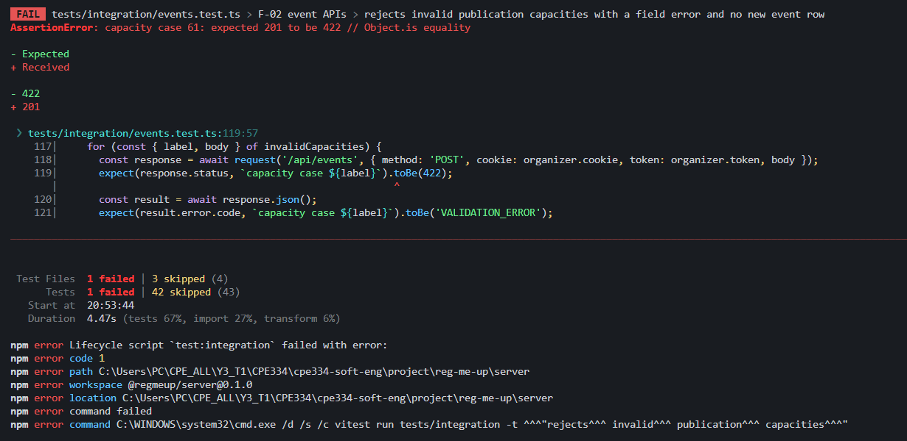

## Integration GREEN — matching targeted case

| Field | Recorded value |
|---|---|
| Command | `npm run test:integration --workspace server -- -t "rejects invalid publication capacities"` |
| Run time shown | 20:57:58 |
| Source | GREEN implementation `db09ba6`; working-tree server/client source matches HEAD on inspection. Screenshot does not independently display the SHA. |
| Result | 1 test passed, 42 intentionally skipped; 1 file passed, 3 skipped. |
| Assertions reached | Invalid capacity responses have status422, VALIDATION_ERROR and a capacity field error; event count for the fixture owner is unchanged. |

## Integration GREEN — full regression

| Field | Recorded value |
|---|---|
| Command reported | `npm run test:integration --workspace server` (the capture begins at the Vitest RUN line). |
| Run time shown | 20:58:46 |
| Source | GREEN implementation `db09ba6`; screenshot does not independently display the SHA. |
| Result | 4 files passed; 43 tests passed; no failed or skipped cases shown. |
| Coverage | Existing database, auth, demo provisioning and event API suites, including publish boundaries, authorization, full/duplicate/concurrent registration and persisted retrieval after restart. |
| Limit | This suite does not yet include the planned capacity61/ACTIVE60 legacy registration fixture or browser UI verification. |

## Legacy integration verification

| Field | Targeted legacy run | Full regression with legacy |
|---|---|---|
| Command reported | `npm run test:integration --workspace server -- -t "preserves legacy capacity 61"` | `npm run test:integration --workspace server` |
| Run time shown | 21:10:20 | 21:13:19 |
| Result | 1 passed, 43 intentionally skipped; 1 file passed, 3 skipped | 44 passed, no failed/skipped cases shown; all 4 files passed |
| Source provenance | HEAD at inspection: `10f8c2d` plus uncommitted changes to `server/tests/integration/events.test.ts` adding the legacy case | Same inspected source state; screenshots do not independently display a commit SHA |
| Evidence scope | Capacity61/ACTIVE60 legacy fixture remains readable; 61st registration succeeds; next registration is full; original event and existing registrations are preserved | Database, auth, demo provisioning and event APIs, including the added legacy case, passed in this user run |

The captures begin at the Vitest RUN line; commands are documented from the requested execution flow. These results were obtained before the new test changes were committed. Do not attribute them to a committed test revision that did not yet exist. The 43-test result above is retained as earlier history.

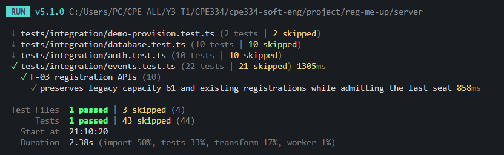

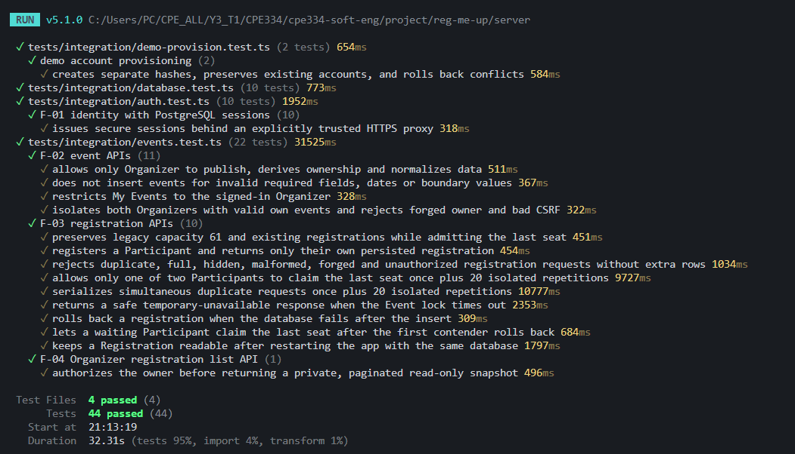

## Remaining evidence

1. Local test-database inventory succeeded and its screenshot is saved below. Actual deployment inventory remains unverified; synthetic compatibility and local inventory do not establish deployment contents.
2. Part B report consolidation and implementation PR review/CI remain pending. Typecheck/build PNG captures are now present (observations below).

Terminal screenshots were supplied by the user; UI attachments below were copied unchanged from the user's Playwright report. Unit, integration, browser and local test-inventory results are recorded for these runs. Deployment database inventory is unverified.

## Browser verification — first run

User report at 21:20:21 shows 15 browser tests: 14 passed, 1 failed, no skipped/flaky cases. All four new Lab7 capacity cases passed. The existing Organizer publish/retrieval case failed on the My Events link locator: partial accessible-name matching found the original title and all three capacity-suffixed titles (4 elements). Local `test-results/.../error-context.md` confirms a strict mode violation at the final owner-list assertion. This is a test selector failure after publication, not evidence that publication failed.

The selector now uses `getByRole('link', { name: title, exact: true })`. Its subsequent full browser rerun passed, recorded below. This first run is retained as failure/fix history. Follow [verification handoff](verification-handoff.md) for reproduction and the read-only inventory.

## Browser verification — passing rerun

| Field | Recorded value |
|---|---|
| Command reported | `npx playwright test e2e/f-02.spec.ts --reporter=list,html` |
| Result | 15 passed in 25.2s, using one worker; local `test-results/.last-run.json` also reports passed with no failed tests. |
| Source provenance | HEAD at inspection `10f8c2d` plus uncommitted `e2e/f-02.spec.ts` changes, including the exact-name selector fix. Screenshot does not display a SHA or start time. |
| Positive boundaries | Capacity1/30/60 each publishes successfully; reload and anonymous retrieval preserve the capacity. |
| Negative boundary | Capacity61 retains the form and displays the range error; test asserts focus, zero publication requests and zero matching event rows. |
| Regression | Original publish/retrieval, cancel, session expiry, unknown publication outcome, validation, pending state, read/empty states and responsive layouts all pass. |
| Artifacts | Four UI screenshots copied directly from the latest local Playwright report attachments; terminal summary supplied by user. Test-created events are cleaned up after the suite. |

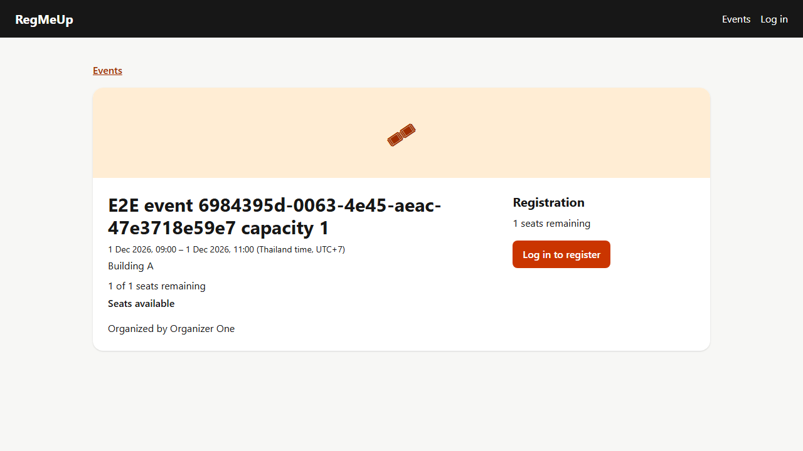

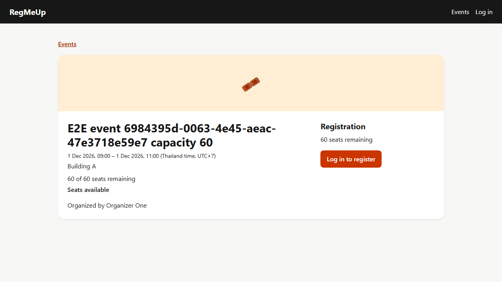

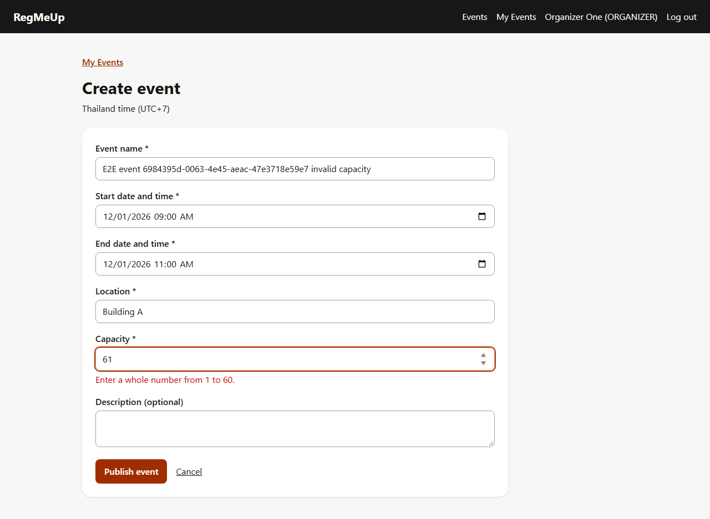

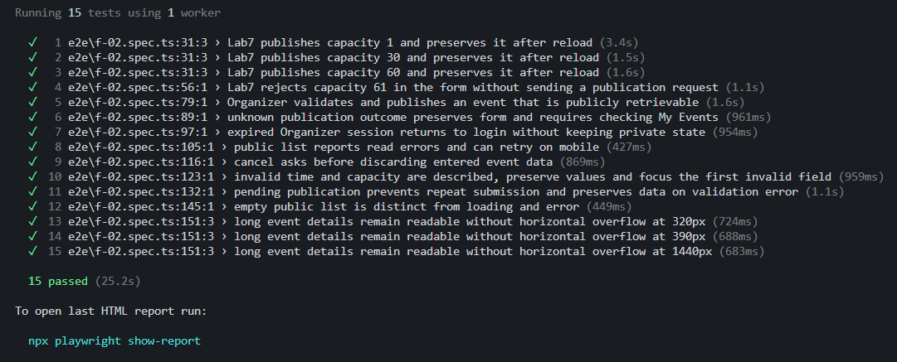

## Typecheck and build — user captures

| Command | Observed output |
|---|---|
| `npm run typecheck` | Client `tsc --noEmit`; server Prisma generate followed by `tsc --noEmit`. Capture shows Prisma Client7.10.1 generated and no TypeScript diagnostics or npm error. |
| `npm run build` | Client TypeScript/Vite8.3.6 build completes; server runs Prisma generate followed by `tsc -p tsconfig.build.json`. Capture shows no TypeScript diagnostics or npm error. |

Source: user-supplied screenshots, saved as `16-typecheck.png` and `17-build.png`. Neither capture shows a numeric exit code or returned command prompt, so those details are not independently established from the images. Prisma's available-version banner is informational; no dependency update was performed. HEAD at inspection remains `10f8c2d` with uncommitted follow-up test/evidence changes. The assistant did not rerun these commands.

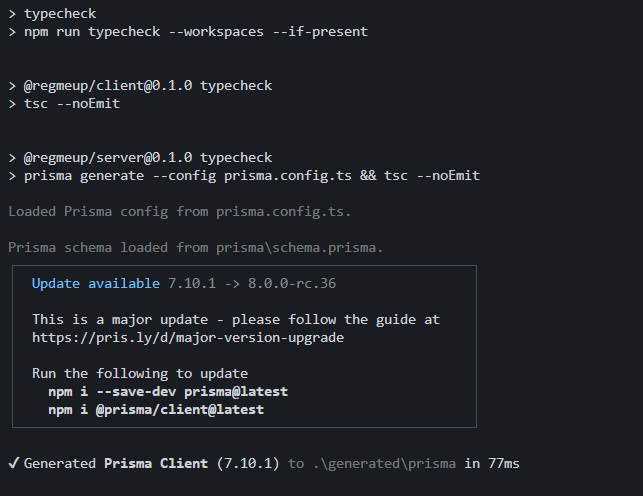

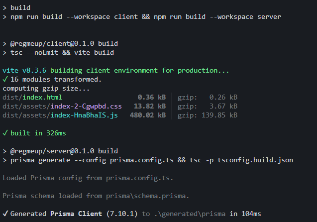

## Local inventory attempt — missing schema

User capture shows timestamp `2026-11-26 14:37:35.813365+00` (21:37:35 Asia/Bangkok), database `regmeup_dev`, then `ERROR: relation "events" does not exist`. No legacy count was produced. This is not evidence of zero legacy rows and does not establish a deployment inventory. Local tests were prepared in `regmeup_test`; the handoff now uses that database for the local test inventory. No migration or data changes were performed in response to this error.

## Local test inventory — successful rerun

| Field | Observed result |
|---|---|
| Database | `regmeup_test` in the reported local Docker project `lab6-capacity-regression` |
| Database timestamp | `2026-11-26 14:40:09.077566+00` (21:40:09 Asia/Bangkok) |
| Events with capacity >60 | 0 |
| Detail rows | 0 rows |
| Transaction | COMMIT displayed; no SQL error shown |
| Endpoint details | Server address/port fields are blank in the psql output (local socket); SQL does not independently establish the host-mapped port55433. |
| Scope | Only local test data after fixture cleanup. Not a deployment/production audit; synthetic legacy behavior is separately covered by the passing integration case. |

Source: user-supplied screenshot saved as `15-legacy-inventory-local.png`. No additional database run was performed by the assistant.

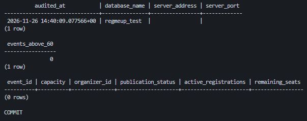
