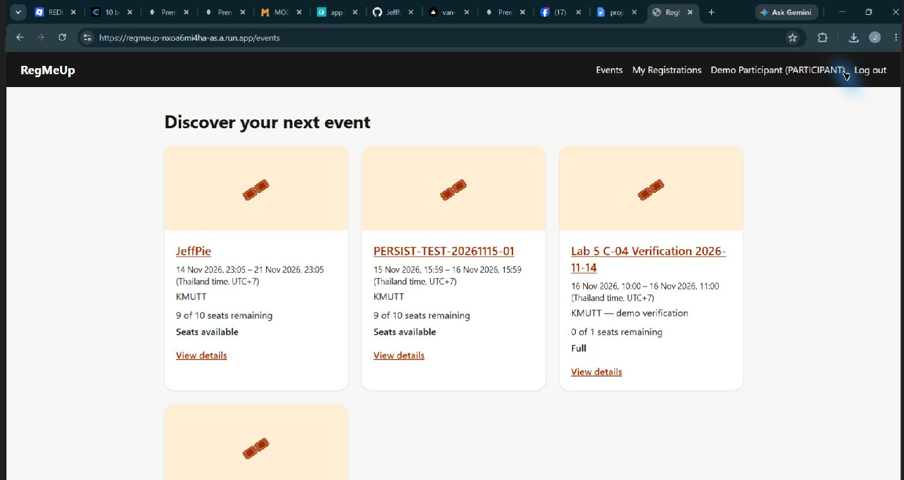
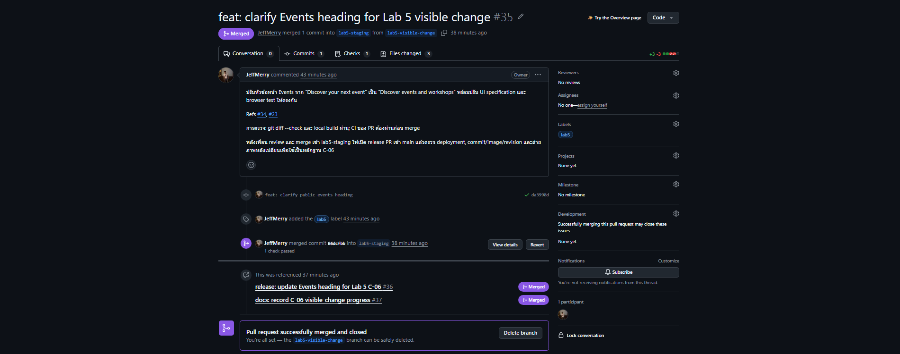
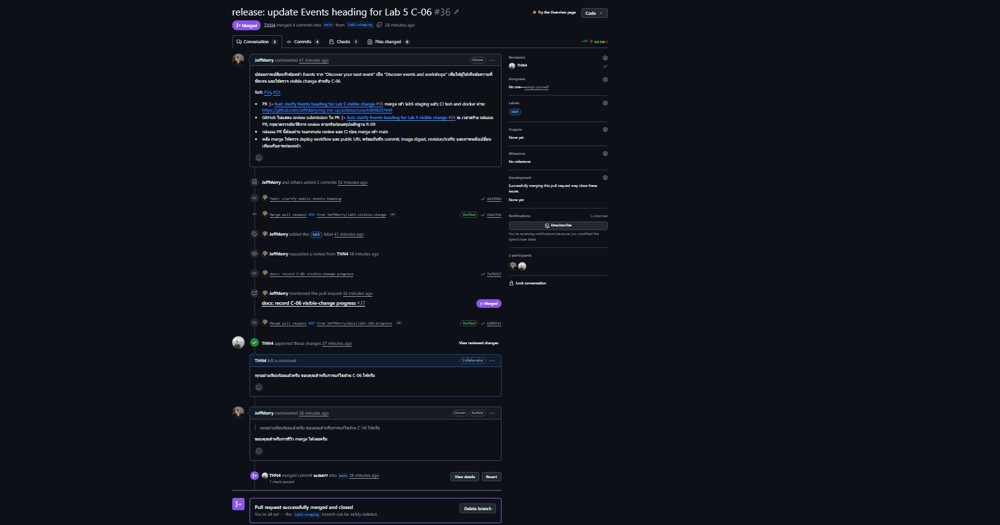
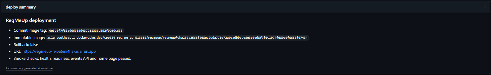
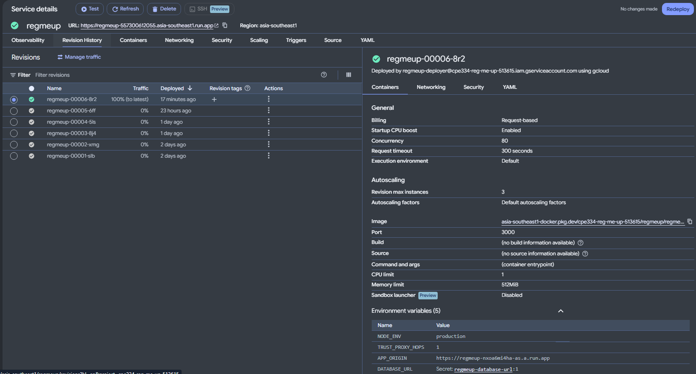

# C-06 — Visible-change release evidence

## Recorded outcome

Issue [#34](https://github.com/JeffMerry/reg-me-up/issues/34) changes the Events heading from **Discover your next event** to **Discover events and workshops**. Implementation PR [#35](https://github.com/JeffMerry/reg-me-up/pull/35) merged into `lab5-staging`. Release PR [#36](https://github.com/JeffMerry/reg-me-up/pull/36), including documentation PR [#37](https://github.com/JeffMerry/reg-me-up/pull/37), then merged into `main`.

Deployment, revision and the before/after screenshots are present in the Google Doc, including the user-inserted Figure 4.3 showing **Discover events and workshops**. **C-06/R-09 is not declared fully passed:** PR #35 has no recorded pre-merge teammate review. The approved release PR does not retroactively establish that review.

| Field | Recorded evidence |
|---|---|
| Implementation PR | #35; author/merger JeffMerry; no review submissions returned by GitHub when checked |
| Implementation CI | [43898257449](https://github.com/JeffMerry/reg-me-up/actions/runs/43898257449), passed |
| Release PR | #36; author JeffMerry; approved and merged by THN4 |
| Release review | [THN4 approval](https://github.com/JeffMerry/reg-me-up/pull/36#pullrequestreview-5923010577); the recorded comment is a general approval and does not describe a specific test/check |
| Release commit | `6e3b8f7f81ed66619d437218336d852fb20dc635` |
| Deploy run | [43902010090](https://github.com/JeffMerry/reg-me-up/actions/runs/43902010090), successful `push` deployment from main |
| Image digest | `sha256:2568f808ec2dda771e72a0eadbbade8e3e8ed8f7f0c1977f080e5f6653f67434` |
| Running revision at capture/deploy | `regmeup-00006-8r2`, 100% traffic; point-in-time evidence, not a continuous live-state check |
| Smoke checks | Health, readiness, events API and home page passed |
| Public URL | <https://regmeup-nxoa6mi4ha-as.a.run.app> |
| Post-deploy visible heading | Present in Figure 4.3 of the [Lab05 Google Doc](https://docs.google.com/document/d/10hasduyk-67Tx8JXNkQesLA5q509kPq_N0FGYTxY6LE/edit?tab=t.nqdn7scarlrh), with URL and **Discover events and workshops**; caption references the release SHA, run and revision. This is a native embedded document image; a separate copy is not currently stored in this repository. |

## Figure captions for the PDF

**Figure 4.2 — C-06 (R-07–R-08):** Public Events page before Issue #34 / PR #35, showing **Discover your next event**. The captured serving revision was not independently queried.

Source: baseline screenshot already tracked in the Lab 5 staging branch.

**Figure 4.7(a) — C-06 (R-09):** PR #35 was merged into `lab5-staging` by its author, JeffMerry; the captured page shows **No reviews**. This records the workflow gap and is not approval evidence.

Source: <https://github.com/JeffMerry/reg-me-up/pull/35>

**Figure 4.7(b) — C-06 (R-09):** Release PR #36 received THN4 approval before THN4 merged it into `main`; merge commit `6e3b8f7f81ed66619d437218336d852fb20dc635`. The approval comment is general; do not claim a specific review check that was not recorded.

Source: <https://github.com/JeffMerry/reg-me-up/pull/36#pullrequestreview-5923010577>

**Figure 4.8 — C-06 (R-07–R-08):** Deploy run `43902010090` released main commit `6e3b8f7f81ed66619d437218336d852fb20dc635`; the summary records its immutable image digest, `Rollback: false`, public URL and passing smoke checks.

Source: <https://github.com/JeffMerry/reg-me-up/actions/runs/43902010090>

**Figure 4.9 — C-06 (R-08):** Cloud Run revision `regmeup-00006-8r2` receives 100% traffic in the supplied capture. The image URI in the Console screenshot is truncated; compare the full digest in Figure 4.8 and the deployment run logs for the same release.

Source: supplied Cloud Run Console screenshot, corroborated by [deploy run 43902010090](https://github.com/JeffMerry/reg-me-up/actions/runs/43902010090).

## Review gap and remaining evidence

- Keep PR #35's original history. Do not describe a later review as having happened before that merge.
- A teammate can inspect the exact change and record the checks/findings now, explicitly as a **post-merge review**. This documents the inspection but does not erase the R-09 process deviation.
- For further corrections, use a new Issue/feature or fix PR into staging, obtain a specific teammate review before merge, then use a reviewed release PR into main. Document the actual sequence and ask the TA how the original deviation affects C-06/R-09 assessment.
- **Figure 4.3 is already present in the Google Doc** and is paired with Figure 4.2 for before/after comparison. Retain that evidence and its source links; do not label the after screenshot as pending.

## Image handling

The four supplied PNG files were copied without alteration. No plaintext passwords, tokens, private keys or database connection strings were visible. Project identifiers, public URLs, service-account identifiers, secret-reference names, commit SHAs and image digests were retained as traceability information. The Console shows a Secret Manager reference, not its secret value. The full-page PR screenshots are supporting context; use their direct review links for readable review text in the PDF.

## Latest PR register for C-06

| PR | Change and branch | Review / outcome | Merge SHA |
|---|---|---|---|
| [#35](https://github.com/JeffMerry/reg-me-up/pull/35) | Events heading, UI specification and browser test; lab5-visible-change → lab5-staging | No review submissions; merged by author JeffMerry. CI 43898257449 passed. | `66dcfbb7b7746e9f24c89cb5b9d661da9d516d49` |
| [#36](https://github.com/JeffMerry/reg-me-up/pull/36) | Visible-change release; lab5-staging → main | THN4 approved and merged. Approval is general, without a recorded specific check. Latest release CI 43901358221 and deploy 43902010090 passed. | `6e3b8f7f81ed66619d437218336d852fb20dc635` |
| [#37](https://github.com/JeffMerry/reg-me-up/pull/37) | C-06 progress documentation and before image; docs/lab5-c06-progress → lab5-staging | No review submissions; merged by author JeffMerry. CI 43900865374 passed. Included in release PR #36. | `6d987a112b628d32e4269ccdf958fc9fdf3ae065` |
