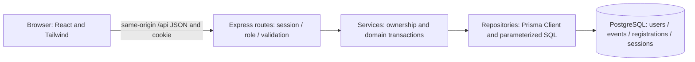
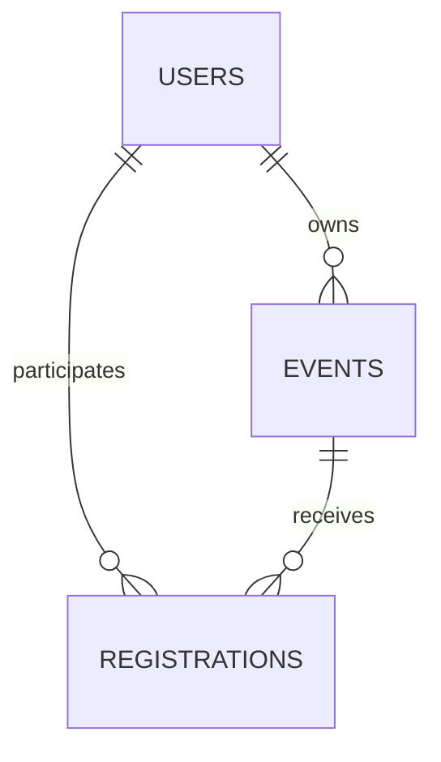

# RegMeUp — System-Level Software Design Specification

Version0.8 — 2026-11-27 (Asia/Bangkok). Design and implementation checkpoint: baseline architecture plus reviewed Sprint2 F05/F06/F09 and F07 check-in are integrated through7c85dcc; F08 report remains a contract/design only. Existing architecture/endpoint/data definitions and later feature extensions below are retained. [Per-AC evidence](sprints/deliverable-2/feature-completion.md), [actual result matrix](sprints/deliverable-2/current-traceability.md) and [release readiness](sprints/deliverable-2/readiness.md) define executed scope and open verification. [SRS](srs.md) remains the requirement authority; no main deployment or full final architecture acceptance is claimed by this status update.

## 1. Architecture and stack

| Layer | Selected approach | Responsibility |
|---|---|---|
| UI | React + TypeScript + Vite + Tailwind CSS | UI-01–07/04-D and shared states from [ui-spec](ui-spec.md); identity-driven controls, form feedback, responsive/keyboard behavior |
| Application | Node.js + Express + TypeScript, one backend | JSON endpoints, session/role checks, validation, domain ownership, registration transaction and safe errors |
| Persistence | PostgreSQL, Prisma ORM and Prisma Migrate; parameterized SQL for row locks and unsupported features | Durable entities/sessions, FK/check/unique constraints, transaction/row locks |
| Verification | Vitest + real test PostgreSQL + HTTP requests; Playwright selected E2E | Unit rules; API/DB/auth/concurrency; critical user journeys and manual UI supplements |

One deployable application is sufficient; logical layers do not require multiple servers. Planned structure: `client/`, `server/`, `server/prisma/` (schema and migrations), `server/tests/`, `e2e/`. Controllers map HTTP; services implement rules/transaction boundaries; repositories accept the transaction client. Never take identity/ownership from client-supplied role/user IDs.

Local Vite proxies `/api` to backend. Release design serves static frontend build and API through one origin, with persistent database storage outside temporary app filesystem. Docker/CI/GCP provisioning happens in Lab 5; no container/cloud resource exists from this document. ENG-01 existing runtime/dependency targets are in [dependency versions](dependency-versions.md); exact Prisma package versions and compatibility still need selection and verification. Actual provisioning/install/lockfile/build verification on both machines remains pending; [SYS-01 preparation](sprints/sprint-1/sys-01.md) defines its scope and test design.

## 2. Conceptual model and Sprint 1 dictionary

All domain IDs are UUIDs generated on server; API field names camelCase, DB columns snake_case. Domain time columns are `timestamptz`. The [Sprint 1 DBML](data-model/sprint-1.dbml) captures the conceptual model and rules; it is a design, not a migration already applied. In the `chore/sys-01-foundation` PR compare DBML against Prisma schema, reviewed migration SQL and the actual session adapter schema; update the DBML whenever the model changes and review any differences.

| Table | Fields / constraints |
|---|---|
| users | `id uuid PK`; `email text NOT NULL UNIQUE`, normalized trim/lowercase; `password_hash text NOT NULL`; `display_name text NOT NULL` length 1–100 after trim; `role text NOT NULL` in PARTICIPANT/ORGANIZER; `created_at timestamptz NOT NULL` server time |
| events | `id uuid PK`; `organizer_id uuid NOT NULL FK users(id)`; `title text NOT NULL` length 1–200 after trim; `starts_at/ends_at timestamptz NOT NULL`, end > start; `location text NOT NULL` length 1–300 after trim; `capacity integer NOT NULL` > 0 and within PostgreSQL INTEGER storage range; newly created/published events are restricted by BR-01 to 1–60 inclusive; no global `capacity <= 60` constraint, to preserve existing rows; `description text NULL` max 10,000; `publication_status text NOT NULL` in PUBLISHED/UNPUBLISHED; `created_at timestamptz NOT NULL` |
| registrations | `id uuid PK` also displayed reference; `event_id/participant_id uuid NOT NULL FK`; `status text NOT NULL` = ACTIVE in Sprint 1; `registered_at timestamptz NOT NULL` server time; unique active event/participant pair |
| sessions | Logical name for the library PostgreSQL store table: `sid` PK, serialized `sess`, indexed `expire`; SYS-01 owns the initial versioned session schema. The shipped `connect-pg-simple` table is named `session` by default; configure its table name if using `sessions` and verify the selected package's exact SQL. No users FK is implied by the serialized user ID. |
| _prisma_migrations | Prisma Migrate-managed migration history/checksums; do not manually edit the ledger or previously applied migration files |

DB indexes: unique normalized email; `events(publication_status, starts_at, id)` for public list; `events(organizer_id, created_at, id)` for own list; `registrations(event_id, status, registered_at, id)` and `(participant_id, registered_at, id)`; partial unique `(event_id,participant_id) WHERE status='ACTIVE'`. Naming convention uses descriptive `..._active_pair_unique` to map only the known duplicate constraint safely.

FK deletes use RESTRICT for domain history; Sprint 1 has no domain delete endpoints. Backend services verify user role before creation; FK to users alone does not prove Participant/Organizer role. Remaining seats = capacity minus active count; no stored counter or client-calculated authoritative availability. Publication always creates PUBLISHED atomically; UNPUBLISHED supports exclusion/negative fixtures without draft/unpublish API or UI.

Text lengths count Unicode code points consistently in UI/server/DB; no automatic Unicode normalization of passwords. Trim title/location/display name; description that is null/omitted/whitespace-only stores null, otherwise preserve plain text within length limit. No HTML rendering of description. Email trim/lowercase is an application account convention, used consistently in seed/login; valid email format, maximum 254 code points. Password is a nonempty string, maximum 1,024 UTF-8 bytes, preserved exactly; these last limits are technical v0.1 details for review, not original course requirements.

For newly created/published events, capacity accepts only a JSON number that is an integer from 1 through 60 inclusive; reject missing/null values, numeric strings, fractions, values below 1, and values above 60. PostgreSQL INTEGER remains the storage representation (1–2,147,483,647); this is a technical storage range, not the publication rule. Do not impose a global `capacity <= 60` constraint: existing events above 60, their IDs, registrations, and ownership remain readable and unchanged. Timestamps must be actual valid dates with explicit offset, end strictly after start. No future-start/minimum-duration/start-or-end registration cutoff is introduced in Sprint 1.

Later concepts: Instructor assignments link event to Instructor users; Attendance links registration to check-in data. Do not create their tables/status transitions now; Q-04–09 and later contracts decide cardinality/history/eligibility before migrations. Current ACTIVE constraint must be revised explicitly before cancellation is added.

## 3. Transaction and consistency design

F-03 write protocol: use one Prisma interactive `$transaction` with explicit `ReadCommitted` isolation and its `tx` client for every lock, read and write. Use parameterized `tx.$queryRaw` for `SELECT ... FOR UPDATE`; never use the root Prisma client or a separate pool inside this transaction:

1. Authenticate and require Participant before the transaction. Set transaction-local PostgreSQL lock timeout 2 seconds and statement timeout 5 seconds; configure Prisma transaction acquisition/runtime limits separately so they are compatible with this protocol. These are design parameters, not an SLA; verify driver/Prisma error mapping and settings in real integration tests.
2. `SELECT` event row by ID `FOR UPDATE`; reject missing/unpublished as 404 and rollback.
3. In a **separate subsequent statement after acquiring lock**, query current Participant's active pair. If present, rollback and return 409 ALREADY_REGISTERED with that user's registration ID. Duplicate has precedence over full.
4. In a subsequent statement count active registrations for this event. If count >= capacity, rollback and return 409 EVENT_FULL.
5. INSERT ACTIVE registration through the same `tx` with server identity/ID/time. Return 201 only after `$transaction` resolves and commit is confirmed; Prisma manages the transaction connection. Throw on failure to roll back, and release application resources on shutdown.

The event lock serializes all registration writers for one event. READ COMMITTED allows the statements after lock acquisition to see committed registrations from the previous holder; do not combine count with a pre-lock snapshot query. Unique active pair is independent duplicate protection, not a capacity constraint. No promise that an ORM/library automatically provides these invariants.

Every writer changing active count or capacity must take Event lock first; Sprint 2 cancel/capacity paths extend the same protocol. Without this shared protocol, a count check/transaction alone does not guarantee BR-02. Seed/test fixture writers are isolated from live requests; runtime credentials do not give clients direct DB access.

On known constraint duplicate, rollback and query the existing pair using authenticated identity; return only own ID. On lock timeout/deadlock with confirmed rollback, 503 TEMPORARILY_UNAVAILABLE; no hidden retry of mutation in Sprint 1. Other unhandled failures use safe 500 INTERNAL_ERROR. If COMMIT outcome cannot be confirmed after a lost DB connection, classify 503 OUTCOME_UNKNOWN and let UI reconcile own state; do not claim rollback/definite failure. Network disconnects can also leave outcome unknown. No response may expose SQL/stack traces.

List rows, total and counts in one response must use one consistent DB snapshot: one SQL statement, or a short read-only REPEATABLE READ transaction for multiple statements. Owner resource selection filters organizer ID before private queries/response construction. Owner-only failure never returns metadata/registrants/totals. Public metadata stays accessible through the public endpoint.

Design sources: [PostgreSQL isolation](https://www.postgresql.org/docs/current/transaction-iso.html), [row locking](https://www.postgresql.org/docs/current/explicit-locking.html), [partial unique indexes](https://www.postgresql.org/docs/current/indexes-partial.html), [Prisma interactive transactions](https://www.prisma.io/docs/orm/v7/prisma-client/queries/transactions), [Prisma parameterized raw queries](https://www.prisma.io/docs/orm/v7/prisma-client/using-raw-sql/raw-queries). These explain available mechanisms; TEST-06/07 must still prove RegMeUp behavior.

## 4. Authentication and permission matrix

`express-session` + `connect-pg-simple` store; session secret server-side. Anonymous bootstrap creates a pre-auth session/CSRF token; session data holds user ID only after successful login plus `authenticatedAt`. Read current user/role from DB on authenticated requests; unknown/deleted user means 401.

Passwords use Argon2id via library with fresh random salt, v0.1 baseline m=19,456 KiB, t=2, p=1. Do not write a custom hash function; performance tuning upward requires recorded reason/regression. These parameters follow [OWASP's minimum Argon2id configuration](https://cheatsheetseries.owasp.org/cheatsheets/Password_Storage_Cheat_Sheet.html); no runtime benchmark has been performed.

Login validates CSRF and credentials, uses generic wrong-credential response (unknown user/wrong password), regenerates session ID, sets authenticatedAt, rotates CSRF, persists session before 200. Return new CSRF token alongside identity. Password is not trimmed/logged/returned. No client role selector. Failure must not create an authenticated session.

Absolute authenticated lifetime 8 hours; at `now >= authenticatedAt + 8h`, deny as 401 even if a cookie/store row remains. Do not roll lifetime on activity; cookie/store expiry must not extend authenticated access beyond that time. Pre-auth sessions have no authenticated permissions. Logout destroys store session, clears matching cookie and returns 204 only on success; old SID fails authenticated reads. Unauthenticated logout returns 401; client handles already-expired state without claiming a failed network request logged out server-side.

Cookie name `regmeup.sid`; HttpOnly, SameSite=Lax, Path=/, no Domain; Secure in HTTPS production, explicit false only in local HTTP config. Configure trusted proxy only for the actual reverse proxy. Same-origin deployment/dev proxy, no wildcard credentialed CORS. Auth/private responses Cache-Control: no-store. UI rechecks identity and clears private state on logout/expiry/role changes; Browser Back does not reveal retained private content.

CSRF: 32 random bytes encoded base64url, session-bound synchronizer token; bootstrap GET gives current token; mutation sends `X-CSRF-Token`. Validate configured Origin on browser POST; non-browser tests send configured Origin too. Missing/invalid token/origin → 403 CSRF_INVALID. Rotate on login and return replacement token; UI refreshes after expiry. Do not use CSRF token as identity or depend only on SameSite.

| API operation | Anonymous | Participant | Organizer | Ownership / verification |
|---|---|---|---|---|
| CSRF bootstrap, login | Allowed with CSRF for login | Allowed; UI redirects authenticated login view | Same | TEST-01/02/14 |
| me, logout | 401 | Own identity/session | Own identity/session | TEST-01/02 |
| Public published list/detail | Allowed | Allowed | Allowed | No private fields; TEST-11 |
| Publish event | 401 | 403 | Allowed | owner from session; TEST-03/09/15 |
| My Events | 401 | 403 | Own rows only | Query filters organizer; TEST-09/15 |
| Register | 401 | Allowed for self | 403 | no participantId body; TEST-04–07/09 |
| Own registration list/status/detail | 401 | Own records; other ID 404 | 403 | TEST-04/09/10 |
| Event registrations | 401 | 403 | Owner only; non-owner 404 | Metadata/rows/totals all protected; TEST-08/09 |

Protected requests check session → role → CSRF for POST → request schema → resource access → domain rule. Tests for role/ownership supply otherwise-valid requests; this avoids mistaking CSRF rejection for authorization. Malformed JSON can be 400 before application checks; never leaks private data. Instructor has no Sprint 1 account/endpoint; adding its role requires explicit Sprint 2 migration/access tests.

Reference: [express-session lifecycle and stores](https://expressjs.com/en/resources/middleware/session/), [PostgreSQL store](https://github.com/voxpelli/node-connect-pg-simple).

## 5. API, DTO and error conventions

REST/JSON under `/api`; GET is read-only. Body parser limit 64 KiB for JSON (technical v0.1 limit); non-JSON mutation → 415 UNSUPPORTED_MEDIA_TYPE; malformed JSON → 400 BAD_REQUEST; over-limit payload → 413 PAYLOAD_TOO_LARGE. Validate all inputs server-side, reject unknown body fields/unsupported query parameters with 422. SQL identifiers/sort orders are fixed allowlists and values parameterized. Path IDs must be UUID format; invalid IDs return 422, absent resource 404.

Success: `{data: ...}`. Paginated list: `{data: [...], meta: {page, pageSize, total}}`. DTO definitions below are JSON field contracts, not TypeScript implementation:

| DTO | Fields |
|---|---|
| Identity | `id`, `displayName`, `role` (PARTICIPANT or ORGANIZER); no credential/session fields |
| EventPublic | `id`, `title`, `startsAt`, `endsAt`, `location`, `capacity`, `remainingSeats`, `description` (string/null), `organizer: {displayName}` |
| EventOwned | EventPublic plus `activeRegistrationCount`; no registrant list |
| RegistrationOwn | `id` (reference), `status: ACTIVE`, `registeredAt`, `participant: {displayName}`, `event: EventPublic` |
| RegistrantRow | `id` (registration reference), `displayName`, `registeredAt`, `status: ACTIVE`; no email/phone/password/user ID |
| OwnerRegistrations | `data: {event: EventPublic, summary: {capacity, activeRegistrations, remainingSeats}, registrations: RegistrantRow[]}`, `meta: {page,pageSize,total}`; total counts authorized active rows |

Server timestamps emit ISO 8601 UTC (`Z`); API creation accepts ISO 8601 with explicit `Z` or numeric offset, never naive local strings. Browser converts Asia/Bangkok inputs/display and labels Thailand time UTC+7; test overnight/date-boundary round trip. UUID is the reference; no separate ticket number or client-generated reference.

Pagination uses page default 1, pageSize default 20, max 100; positive safe integers only, computed offset must also be safe. `eventId` filter supported only for own registrations, UUID validated; empty match gives empty own list. Fixed ordering: public events startsAt ASC/id ASC; My Events createdAt DESC/id DESC; own registrations registeredAt DESC/id DESC; Organizer registrants registeredAt ASC/id ASC. No unsupported search/sort UI controls.

| Error status | code | Safe shape / meaning |
|---|---|---|
| 400 / 413 / 415 | BAD_REQUEST / PAYLOAD_TOO_LARGE / UNSUPPORTED_MEDIA_TYPE | Transport validation; no raw parser error |
| 422 | VALIDATION_ERROR | `{error:{code,message,fieldErrors?}}`; fieldErrors maps field name to string; no invalid secret values echoed |
| 401 | UNAUTHENTICATED | Missing/expired session; private cache cleared |
| 401 | INVALID_CREDENTIALS | Login only; identical message for unknown account/wrong password |
| 403 | FORBIDDEN / CSRF_INVALID | Wrong role / invalid CSRF-or-origin; no private data |
| 404 | NOT_FOUND | Unknown/unpublished public ID or non-owned private record; safe shared message |
| 409 | EVENT_FULL | New registration denied; no insert |
| 409 | ALREADY_REGISTERED | `{error:{code,message,registrationId}}`, own ID only; duplicate before full |
| 503 | TEMPORARILY_UNAVAILABLE | Known rolled-back contention/deadlock; preserve user input, check state before retry |
| 503 | OUTCOME_UNKNOWN | Commit outcome uncertain; check own state; no definite-failure/success claim |
| 500 | INTERNAL_ERROR | Safe general message; no SQL/token/stack details |

All error bodies use `{error:{code,message,...}}` with optional safe fields just defined; no additional data payload. For a fetch/network timeout with no response, UI treats mutation outcome as unknown. Reads can retry; mutations never automatically retry. Publication exactly-once/idempotency keys are outside selected Sprint 1 design; UI preserves form and offers My Events check before resubmission.

## 6. UI baseline and data dependencies

Use [ui-spec](ui-spec.md) screen layouts/navigation/states verbatim unless a documented revision is made. English interface copy selected for Sprint 1; no localization system required. Tailwind theme matches orange accent #F97316, primary button #C2410C, text #171717, page #F7F7F5, white cards, Noto Sans Thai/fallback, spacing/radii/content width from UI. Create shared Button/Input/Card/navigation rather than diverging styles between members. [Tailwind Vite integration](https://tailwindcss.com/docs/installation/using-vite) is design reference; not installed yet.

| Screen | Data / operations | Important state |
|---|---|---|
| UI-01 | csrf/login/me/logout; F-01 | Generic credentials error, safe returnTo, no automatic register |
| UI-02 | Public event list; F-02 | Published/full visible; loading/empty/error distinct |
| UI-03 | Public detail + own registrations filtered eventId + register; F-02/03 | Identity/status first; already registered before Full; uncertain mutation check |
| UI-04 / 04-D | Own list/detail; F-03 | Authorized modal deep link; no QR/cancel; reload/restart retrieval |
| UI-05 | My Events; F-02/04 | Own rows/counts; create/detail/registrations actions |
| UI-06 | Publish; F-02 | Required fields and optional description; pending/field errors; preserve unknown-outcome form |
| UI-07 | OwnerRegistrations; F-04 | Owner check before private rendering, authorized totals, no private cached-content flash |
| UI-S01 / S02 | Shared denial/not found | No denied names/private fields; safe navigation |

ReturnTo allowlist: `/events`, `/events/:uuid`; Participant `/my-registrations` with optional valid registrationId; Organizer `/organizer/events`, `/organizer/events/new`, owner-list route with UUID. Reject external/protocol-relative URLs, invalid encodings or role-inaccessible paths; fallback Participant `/events`, Organizer `/organizer/events`. Return path never grants resource access. `/` redirects `/events`. Unknown private deep links never render before server authorization.

UI target/reference widths 1440px and 390px; support 320px, tablet/desktop breakpoints per baseline. Real labels, visible focus, first-invalid focus, live region outcomes, modal trap/Escape/restore. Failed reads are errors with retry, never empty success. No optimistic registration success/reference or negative remaining-seat display. Inconsistent counts disable action and offer retry.

## 7. Configuration, migrations, seed and delivery

Server env names: `NODE_ENV`, `PORT`, `DATABASE_URL`, `TEST_DATABASE_URL` (tests only), `SESSION_SECRET`, `APP_ORIGIN`; test clock/synchronization dependencies are injected by test harness, not public HTTP endpoints. Session lifetime/hash/DB timeout values above are named documented constants/config validated at startup, not client overrides. Frontend uses relative `/api`, no secrets or DB credentials. Never print connection strings/session payload/passwords in logs.

Migration plan: use Prisma schema and Prisma Migrate as the single migration history, with ordered initial users+sessions, events, registrations and indexes. Generate and review versioned SQL before applying; customize migration SQL for PostgreSQL checks or other required features not represented by the selected Prisma version. Ensure the partial active-pair unique index exists; Prisma v7 documents a `partialIndexes` preview feature, so decide after exact-version verification whether to use it or reviewed SQL, and test future migration drift either way. Preserve `connect-pg-simple` session table shape; no unversioned session-table auto-creation. Use `migrate dev` only on disposable development databases and the project guarded `db:migrate` command for applying reviewed migrations. Never edit applied shared migrations. Although [Prisma's documentation](https://www.prisma.io/docs/orm/v7/prisma-migrate/workflows/development-and-production) describes a modified-migration warning, a local Prisma 7.10.1/PostgreSQL 18.1 isolated check observed no warning despite a checksum mismatch. Do not rely on that warning: the project preflight design compares applied checksums with local files and rejects missing/modified history or unresolved failed migrations before `migrate deploy`. This preflight does not detect arbitrary schema drift. Test failure/recovery and transaction boundaries; do not assume a failed migration always leaves no partial schema. Schema/migrations are implemented on the foundation branch but not approved or deployed. Seed is an explicit local/test command, hashes passwords, reproducibly creates at least P1/P2/P3/O1/O2, empty/partial/full published events and isolated unpublished fixture. Credentials synthetic and supplied via local seed procedure/private handoff, never real passwords in Git/PDF. No seed/reset on ordinary startup or restart/persistence test.

Planned command interfaces (not runnable today): install pinned deps → configure env → db:migrate → db:seed → dev; build; test:unit; test:integration with TEST_DATABASE_URL; test:e2e against test server. Implementation adds exact cwd/commands to README and records fresh setup TEST-13; never run destructive fixture cleanup against DATABASE_URL/production DB.

D1: local working release, setup/build/tests and reviewed main release. Lab 5: Docker app image, CI PR build/tests + enforced failure gate, accepted main release deployment to GCP compute with persistent PostgreSQL, environment secrets, health/readiness and repeatable pipeline; exact service/resource sizing waits ENG-03/course guidance. DB survives app restart/redeploy; no production/test seed automatically. Container image excludes real secrets. Redeployment durability is separately verified later; TEST-10 proves local app restart only.

## 8. Review and limitations

No code/package/schema/test/migration/container deployed or executed by this document. Existing target versions are documented; exact Prisma package selection and install/lockfile/environment verification remain ENG-01. GitHub CLI confirmed JeffMerry admin and THN4 write access and user-directed Issue assignments; teammate agreement, actual board/settings and feature PR approvals remain ENG-02. Technical v0.1 additions (encoding/limits/hash/timeouts/errors) are explicit design choices for teammate review, not invented stakeholder statements. UI source retains its original pending review; this SDS does not assert teammate acceptance.

| Version | Date | Change | Review |
|---|---|---|---|
| 0.1 | 2026-11-06 | Selected stack/no ORM, model, atomic registration, session/CSRF, DTO/API/UI/config and delivery design | Pending teammate review; correctness NOT VERIFIED |
| 0.2 | 2026-11-06 | Linked exact dependency targets and SYS-01 acceptance/test design; distinguished selection from installation/build evidence | Pending teammate review; application tests NOT RUN |
| 0.3 | 2026-11-10 | Adopted Prisma ORM/Migrate and retained event-lock transaction protocol and PostgreSQL constraints | Pending teammate review; Prisma compatibility and application tests NOT RUN |
| 0.4 | 2026-11-11 | Linked conceptual DBML and assigned the initial session schema to SYS-01 | Pending teammate review; schema not applied |
| 0.5 | 2026-11-11 | Updated Issue-assignment status while retaining pending team agreement and review | Pending teammate review; NOT RUN |
| 0.6 | 2026-11-11 | Recorded observed Prisma warning discrepancy and designed guarded migration preflight | Implementation review pending |
| 0.7 | 2026-11-26 | Defined new-publication capacity 1–60 while retaining PostgreSQL storage range and legacy-row compatibility | Pending teammate review; no schema applied or tests run |

## 9. Sprint 2 extension — confirmed policy, revised 26 November 2026

The sections above preserve Sprint1 design/history; statements about unimplemented setup are historical, not a fresh inspection of main. Sprint2 starts from main `3c8b751a2646408f6fdc88209a0fef33d9030f1b`. Revision26Nov2026: policy/legacy **CONFIRMED** in [actual COMMENTED review](sprints/sprint-2/review-record.md), formal follow-up approval/merge pending; implementation NOT STARTED / acceptance NOT RUN. Shared schema owner Thanatip Nitinantakul (THN4), reviewer Kittithat Disthanakornkun (JeffMerry); shared lock/integration owner Kittithat, reviewer Thanatip; release evidence owner Thanatip, reviewer Kittithat.

The complete [Sprint2 shared system design](sprints/sprint-2/system-design.md) specifies additive deadline/version/cancellation/assignment schema, endpoint and DTO contracts, access matrix, server-clock boundaries and migration/provisioning safeguards. [Policies](sprints/sprint-2/decisions.md) record confirmed rules/legacy policy separately from technical implementation choices requiring code/migration verification. The linked sections are part of this versioned design; include their full assessed content in the D2 PDF, not just links.

Key extensions: all ACTIVE-count/capacity writers retain event row locking; owner edits/assignment changes serialize cross-event scheduling with a proposed transaction advisory mutex before event lock; expectedVersion prevents lost edits; single-role Instructor has current-assignment-only private reads; historical cancellations/assignments persist. Public cutoff fields change explicitly while private fields remain excluded. UI/backend role/returnTo handling must extend together. No applied migration rewrite or automatic live seed is allowed.

Lab7 create capacity rules from main are now included in this document: new publication accepts integer1–60 and legacy stored capacities are preserved. F-06 requires confirmed1–60 only for explicitly supplied capacity edits, under the confirmed legacy policy; omitted legacy capacity is not silently reduced. Do not implement a global DB<=60 constraint from this draft.

Review scope: [F-05](sprints/sprint-2/f-05.md), [F-06](sprints/sprint-2/f-06.md), [F-09](sprints/sprint-2/f-09.md), [STS](sprints/sprint-2/sts.md). No runtime API/schema/config changes are made by this planning extension.

## 10. Integration checkpoint — 27 November 2026

Lab7 release #62 at main `d490632` is being synchronized with Sprint2 staging `882818d`, containing shared locks #55, F-05 #57 and shared events.version #59. Earlier pending/NOT STARTED statements above describe their original design checkpoint. The user reassigned only events.version to Kittithat; Thanatip retains Instructor schema/combined migration coordination. [Updated ownership](sprints/sprint-2/review-record.md) and [version handoff](sprints/sprint-2/event-version-evidence.md) govern current work. F-06 validation remains on its separate work branch; edit API/UI and F-09 acceptance are not established here. Fresh combined-source results belong to the synchronization PR; an automatic Git merge is not verification of those paths.

## 11. Sprint 3 contract extension — 27 November 2026

User-confirmed Q09 specifies owner-only ACTIVE check-in at start≤serverNow<end, repeated check-in preserving its original record/time, no attendance correction/undo, and reports counting distinct people by current state. [F07](sprints/sprint-3/f-07.md), [F08](sprints/sprint-3/f-08.md) and [STS](sprints/sprint-3/sts.md) provide full proposed technical design/AC/error/DTO details for review before implementation; code/tests remain NOT RUN.

Proposed Attendance references a unique registration and actual Organizer actor with timestamp, preserving all existing history. Check-in uses event-row locking shared with cancellation/event editing; no inverse advisory-lock order. Reports are owner-only consistent REPEATABLE READ snapshots: ACTIVE distinct people are registered; cancelled-history people without ACTIVE are cancelled; saved attendance distinct people are attended. A re-registered person is not also currently cancelled. Reports are read-only; no export/QR/undo interface is introduced. This design supplements existing Sprint1/2 source rules and does not claim an applied migration.

Remaining Sprint2 validation and release evidence are assigned to JeffMerry by the later user allocation, with THN4 peer review; see [acceptance audit](sprints/sprint-2/acceptance-audit.md) and [delivery plan](sprints/deliverable-2/plan.md).

## 12. F07 implementation checkpoint — 27 November 2026

At feature candidate `0faf42a`, Attendance is implemented with UNIQUE registration FK, required checked-in timestamp and recorder FK. Owner-authorized roster reads use REPEATABLE READ and safe pagination; check-in uses the shared event row lock with trusted decision time and preserves management version/seat/history. Current eligibility is read after waiting; valid repeats return the original record before testing the new-creation window. Check-in UI is linked from My Events, reconciles uncertain outcomes through explicit GET, and ignores disposed callbacks. [Contract/API/data](sprints/sprint-3/f-07.md) and [actual tests/limits](sprints/sprint-3/f-07-evidence.md) supersede section11's F07 proposed/NOT RUN status for this candidate. F08 report design remains unimplemented. Feature review/main release/deployment are separate pending gates.
